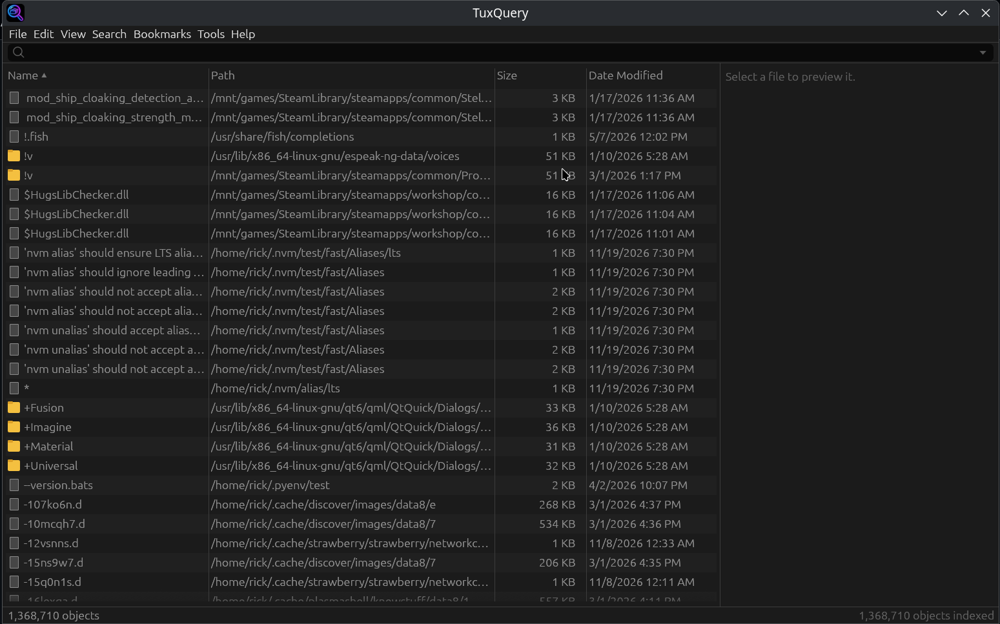
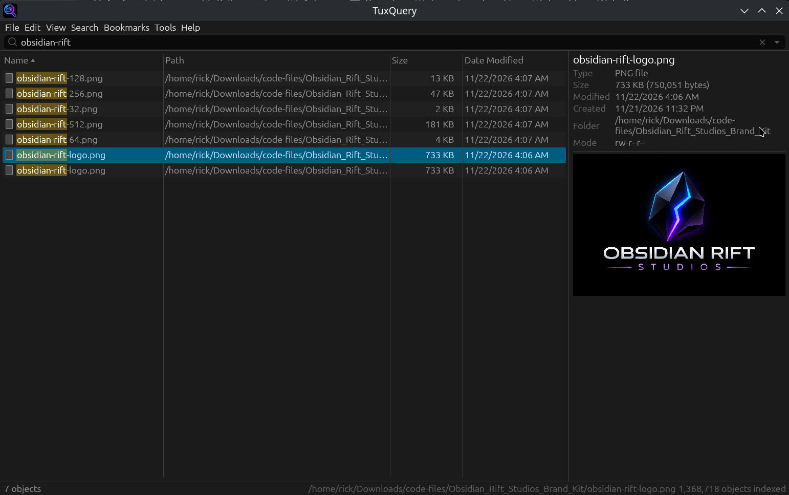
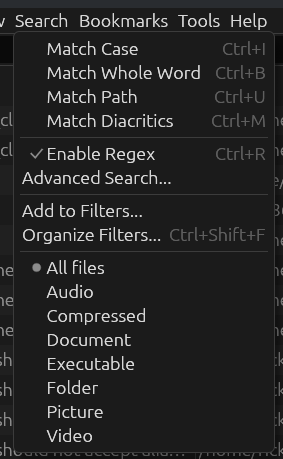

<p align="center">
  
</p>

# TuxQuery


**Instant file search for Linux.** TuxQuery keeps an index of every file name on your computer in memory and updates it live as files change, so a search over millions of files takes a few milliseconds.

Made by [Obsidian Rift Studios](mailto:support@obsidianrift.net). Free for personal use.

## Screenshots







## Download

Get the latest `.deb` package and its checksum from the **[Releases](../../releases/latest)** page.

## Requirements

- 64-bit Linux. Built and tested on **Debian 13**, and it should run on Debian-based distributions of the same age or newer
- A graphical desktop (X11 or Wayland) for the search window. The command-line tools work without one

## Install

```sh
sha256sum -c tuxquery_<version>_amd64.deb.sha256                      # optional: check the download
sudo apt install ./tuxquery_<version>_amd64.deb
```

The installer shows the license agreement ([EULA.txt](EULA.txt)) and asks you to accept it. Then start **TuxQuery** from your application menu, or run `tuxquery` in a terminal. The first scan runs in the background and the search window works while it finishes.

To remove it: `sudo apt remove tuxquery`.

## What it does

**Search**
- Results as you type, even over millions of files
- A rich query syntax: wildcards, `ext:`, `size:`, dates, attributes, regular expressions, match case, whole word, match path and more
- Sort by name, path, size, extension and dates; saved filters, bookmarks, search history and tabs
- Preview pane, thumbnails and media information

**Indexing**
- Indexes all local disks, or only the folders you choose, with exclusion settings
- Live updates through inotify, a cached index for instant startup, a change journal, and live sizes for files that are still being written
- **System-wide mode:** one shared service for every user on the computer, and each user sees only the files they are allowed to open (`sudo tuxquery system on`)
- Network mounts are recognized and handled

**Checks you can trust**
- `tuxquery verify` (or **Tools > Verify Index...**) reads your disks again from scratch and compares them with the index, and lists every file the index has wrong. Help > Verify the index explains the report

**Interfaces**
- Native desktop window with themes, fonts, colors and remappable keyboard shortcuts
- Command line: `tuxquery search`, `status`, `rescan`, `verify`
- Optional web interface (password protected, HTTP or HTTPS)
- Optional ETP/FTP server, and TuxQuery-to-TuxQuery servers so you can search another computer's index
- A small SDK so other programs, such as file managers, can use the index

**Languages:** English, Spanish, French, German, Portuguese, Italian, Russian, Simplified Chinese and Japanese. The translations are machine-drafted and have not yet been reviewed by native speakers, so corrections are welcome.

## Command line

```sh
tuxquery                                       # open the search window
tuxquery search "ext:pdf size:>1mb" -n 20      # search from a terminal
tuxquery verify                                # check the index against the disks
tuxquery autostart on                          # start the daemon at login
sudo tuxquery system on                        # one shared index for all users
tuxquery --version
```

Run `tuxquery` and press **F1** for the built-in help, which covers getting started, the search syntax, shortcuts and troubleshooting.

## Privacy and security

- TuxQuery does not collect or send any data about you or your files. The index stays on your computer
- The web interface, the ETP/FTP server and the TuxQuery server are **off by default**. If you turn them on, you choose the passwords and who can reach them
- Use encryption (TLS) where offered. The ETP/FTP protocol cannot encrypt, so use it only on a network you trust

## License

TuxQuery is **free for personal, non-commercial use**. It is closed-source software: you may not reverse engineer, modify or redistribute it, and commercial use needs written permission from Obsidian Rift Studios. The full terms are in [EULA.txt](EULA.txt). Open-source components used by TuxQuery are listed in the THIRD-PARTY-NOTICES file installed with the program (`/usr/share/doc/tuxquery/`).

## Support and commercial licensing

Questions, bug reports, translation corrections and commercial-use requests: **support@obsidianrift.net**

When reporting a problem, please include the output of `tuxquery --version`, or use **Help > About TuxQuery > Copy**.

---

© 2026 Obsidian Rift Studios. TuxQuery and the Obsidian Rift Studios name and logo are trademarks of Obsidian Rift Studios.
